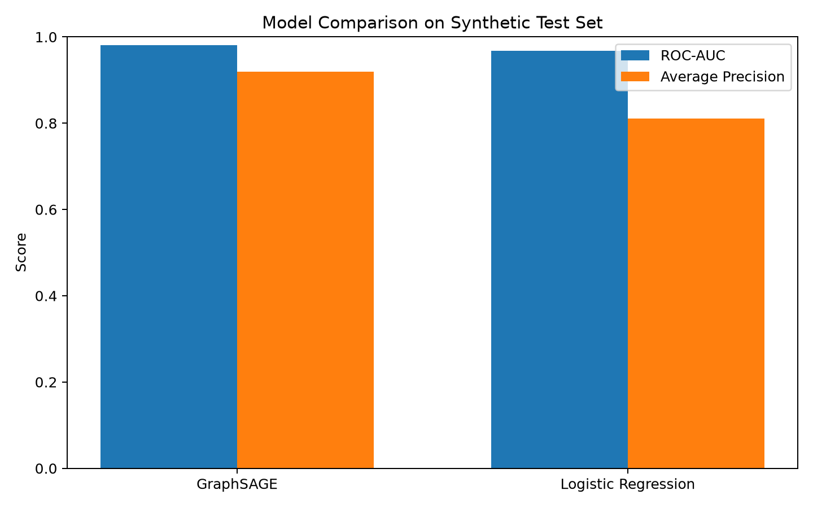
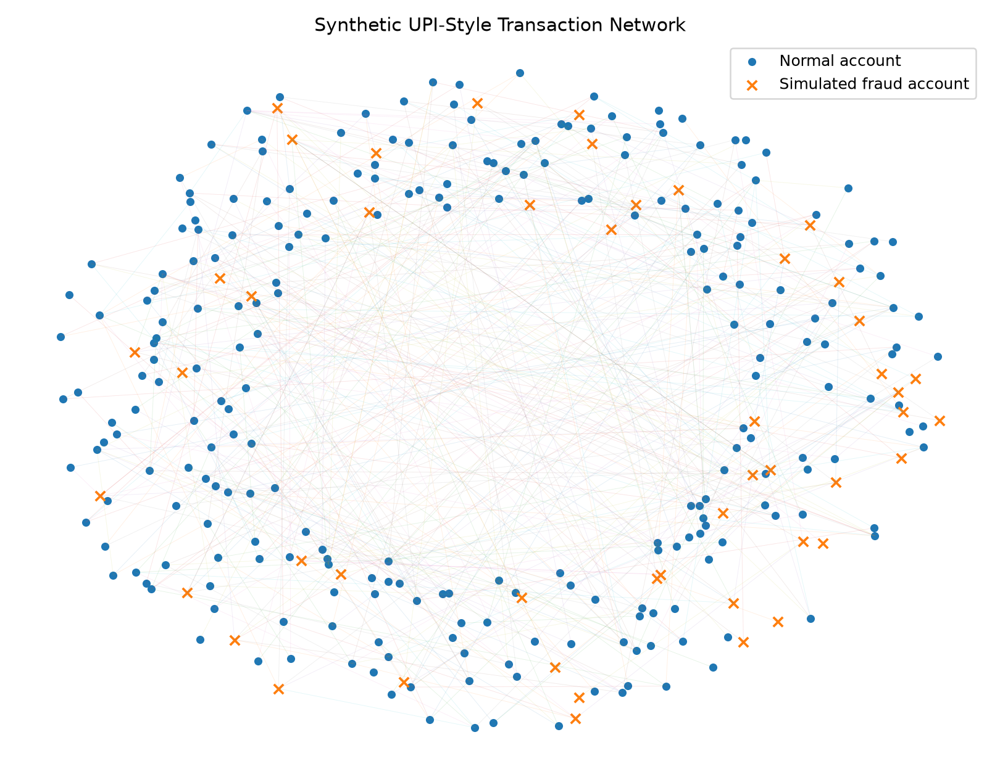

# GraphShield: Graph-Based UPI Fraud Detection

GraphShield is a student machine learning project that identifies potentially suspicious UPI-style accounts by analyzing the relationships between accounts and the transfers connecting them, using graph-based learning.

The project uses **synthetic data** to demonstrate how a graph neural network (GraphSAGE) can help flag suspicious accounts, and compares it with a Logistic Regression baseline.

## Features

- Generates synthetic account and transfer data.
- Represents accounts as nodes and transfers as edges in a graph.
- Uses a GraphSAGE model for node classification (suspicious vs. normal account).
- Compares the graph-based model with a Logistic Regression baseline.
- Reports ROC-AUC, Average Precision, Precision, Recall, F1-score and confusion matrices.
- Provides an interactive dashboard built with Streamlit, including transaction network visualizations.

## Technologies Used

- Python
- PyTorch
- Scikit-learn
- Pandas and NumPy
- Matplotlib and NetworkX
- Streamlit

## Project Structure

```text
GraphShield/
├── app.py
├── requirements.txt
├── run.bat
├── run_dashboard.bat
├── README.md
├── data/
│   ├── accounts.csv
│   ├── transactions.csv
│   └── graph.npz
├── results/
│   ├── graphsage_model.pt
│   ├── metrics.json
│   ├── model_comparison.png
│   ├── test_predictions.npz
│   └── transaction_network.png
└── src/
    ├── generate_data.py
    ├── main.py
    ├── model.py
    ├── train.py
    └── visualize.py
```

## How It Works

1. **Data Generation:** Synthetic accounts and transfers are generated with a fixed random seed (42) for reproducibility.
2. **Graph Construction:** Accounts become nodes and transfers become edges, forming a transaction graph.
3. **Model Training:** A GraphSAGE model learns from each account's features and its neighborhood in the graph to classify the account as suspicious or normal.
4. **Baseline Comparison:** A Logistic Regression model is trained as a baseline.
5. **Evaluation:** Both models are evaluated on held-out test accounts.
6. **Visualization:** The dashboard presents predictions, metrics and network plots.

## Dataset

The project uses a fully synthetic dataset (seed = 42):

| Item | Value |
|---|---|
| Accounts (nodes) | 300 |
| Transfers (edges) | 2,344 |
| Fraudulent accounts | 48 (16%) |
| Train / Validation / Test accounts | 180 / 60 / 60 |

The task is **node classification**: each account is labeled as suspicious or not.

## Results

Evaluated on the 60 held-out test accounts (9 fraudulent) at a 0.5 decision threshold:

| Metric | GraphSAGE | Logistic Regression |
|---|---|---|
| ROC-AUC | **0.980** | 0.967 |
| Average Precision | **0.919** | 0.811 |
| Precision | **0.615** | 0.450 |
| Recall | 0.889 | **1.000** |
| F1-score | **0.727** | 0.621 |

**Confusion matrices** (rows = actual, columns = predicted):

| | GraphSAGE: Pred. normal | GraphSAGE: Pred. fraud | Logistic Regression: Pred. normal | Logistic Regression: Pred. fraud |
|---|---|---|---|---|
| **Actual normal** | 46 | 5 | 40 | 11 |
| **Actual fraud** | 1 | 8 | 0 | 9 |





### Interpretation

- GraphSAGE ranks suspicious accounts better (higher ROC-AUC and Average Precision) and raises fewer false alarms (5 vs. 11), which gives it a higher F1-score.
- Logistic Regression catches every fraudulent account in the test set, but flags 11 normal accounts to do so.
- The test set is small (60 accounts, only 9 fraudulent), so a single account noticeably changes the metrics. These results show the approach works on this synthetic data; they do not prove GraphSAGE is reliably better than the baseline.
- Because the data is synthetic, scores reflect the patterns built into the data generator, not real-world fraud detection performance.

## Installation

### 1. Clone the Repository

```bash
git clone https://github.com/sagar13526/GraphShield.git
cd GraphShield
```

### 2. Create a Virtual Environment (Recommended)

```bash
python -m venv venv
```

Activate it on Windows:

```bash
venv\Scripts\activate
```

Activate it on macOS/Linux:

```bash
source venv/bin/activate
```

### 3. Install Dependencies

```bash
pip install -r requirements.txt
```

## Run the Project

Launch the dashboard:

```bash
streamlit run app.py
```

On Windows you can also use `run_dashboard.bat` (dashboard) or `run.bat`.

If the data or model files are missing, regenerate them first:

```bash
python src/generate_data.py
python src/main.py
```

Then start the dashboard again.

## Limitations

- The project uses synthetic data, not real bank or UPI transaction records.
- Results do not establish real-world fraud detection performance.
- The test set is small (60 accounts, 9 fraudulent), so metrics are sensitive to individual predictions.
- The model is an educational prototype and is not intended for production banking systems.
- Performance depends on the generated data, features and training setup.

## Future Improvements

- Evaluate on suitable real-world datasets where permitted.
- Use larger transaction networks and multiple random seeds to report average results with variance.
- Add temporal graph features to capture changing fraud patterns over time.
- Reimplement the model with a graph library such as PyTorch Geometric.
- Add per-account explanations for why an account was flagged.

## Purpose

GraphShield provides practical experience with synthetic data generation, graph construction, model training, baseline comparison and dashboard development for fraud detection.

**Note:** GraphShield is an educational project. It does not connect to a real UPI system or make decisions about actual financial transactions.
